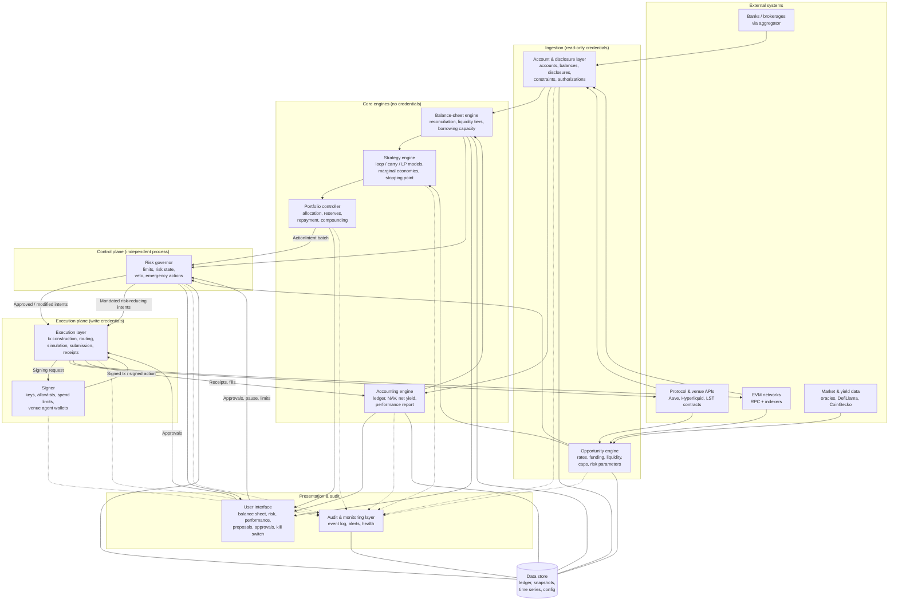
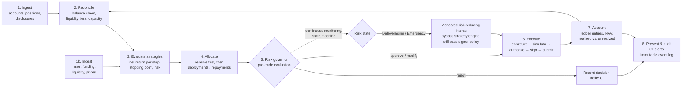
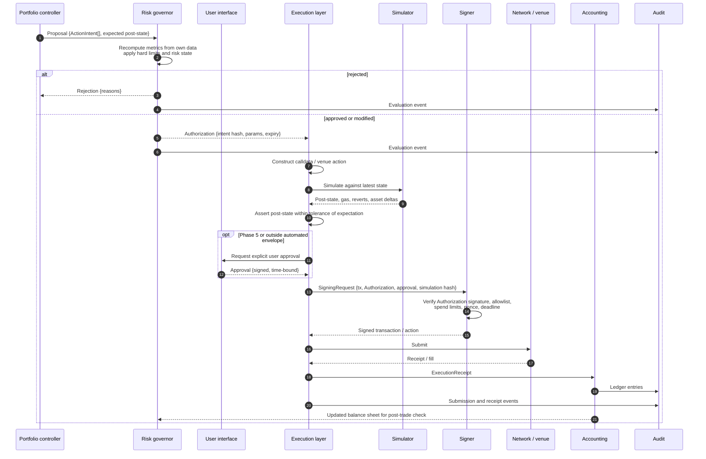
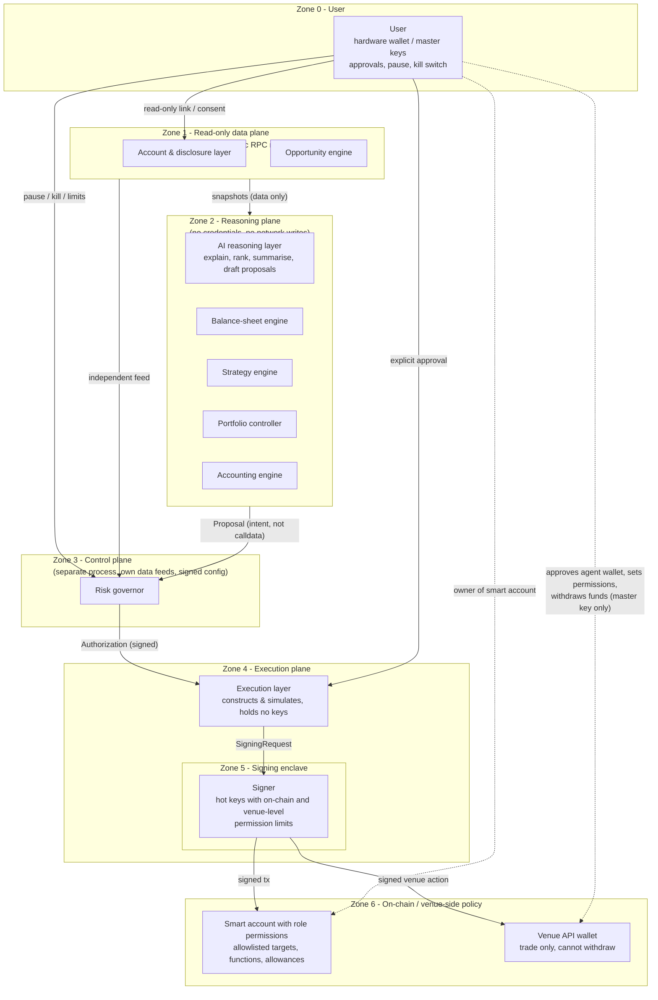
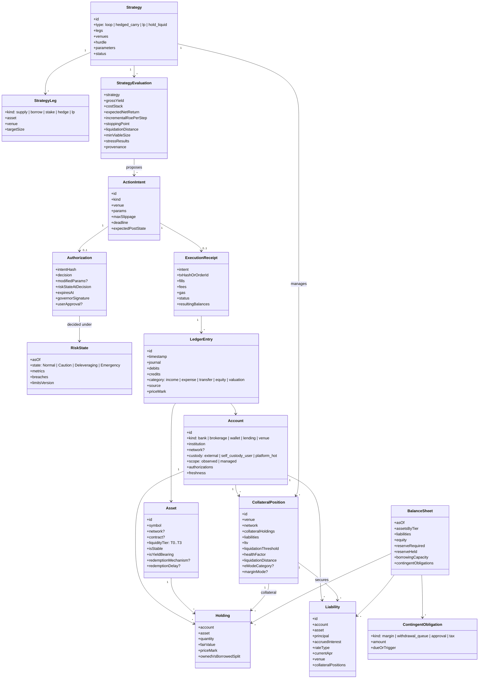

# Product architecture and data flow

Spec deliverable §14.1. Companion documents: [`integrations.md`](integrations.md) (external interfaces), [`risk-governor.md`](risk-governor.md) (limits, states, emergency actions), [`implementation-plan.md`](implementation-plan.md) (phasing). The product specification is [`spec.md`](spec.md); section references below (§n) point to it.

This document describes the target architecture. Phases 1–3 (read-only model, simulator, opportunity/risk engine) are being built first in a TypeScript monorepo; later-phase components are specified here so that early components are shaped to fit them.

---

## 1. Design principles

1. **One balance sheet, not many positions.** Every engine reasons about the consolidated balance sheet (assets, liabilities, equity, collateral, reserves, contingent obligations), never about a single position in isolation (§5, §15).
2. **Deterministic engines, advisory AI.** Balance-sheet reconciliation, strategy economics, risk evaluation, accounting, and transaction construction are deterministic, testable code. An AI reasoning layer may propose, explain, rank, and summarise, but it does not compute NAV, does not decide risk state, and does not sign.
3. **The risk governor has authority.** It evaluates every proposed action before execution, can reject or shrink any action, can mandate risk-reducing actions, and its parameters cannot be changed by the strategy engine or the AI layer (§7).
4. **Read is separated from write.** Read-only integrations (bank aggregation, RPC reads, venue info endpoints) run in a different process and credential scope from anything that can move value (§11).
5. **Signing keys are isolated.** Private keys and venue trading keys live only in a signer component that accepts narrowly-typed, pre-approved intents. The AI layer, strategy engine, and UI never see key material (§11).
6. **Fail closed.** Missing data, stale prices, unreachable governor, or failed simulation all block risk-increasing actions. Risk-reducing actions remain possible with degraded data under explicit rules (see `risk-governor.md`).
7. **Everything is recorded.** Every input snapshot, proposal, evaluation, authorization, transaction, and failure is an append-only audit event (§10 audit layer).
8. **"Do nothing" is a first-class outcome.** The strategy engine and portfolio controller must be able to conclude that no deployment clears the hurdle and hold capital in liquid form (§5, §9).

---

## 2. Component map

The ten modules from §10 plus two infrastructure components that §11 requires but §10 does not name separately: the **signer** (key custody and policy enforcement, logically part of the execution layer but isolated) and the **data store** (ledger, snapshots, time series, audit log).

### 2.1 Interfaces between modules

Interfaces are typed messages (TypeScript types shared from a `domain` package in the monorepo). Names below are indicative.

| Producer → consumer | Interface | Content |
| --- | --- | --- |
| Account & disclosure → balance-sheet | `AccountSnapshot[]`, `DisclosureProfile`, `AuthorizationScope` | Observed balances and positions per account with provenance and freshness; user disclosures (§2B); which accounts/assets the platform may observe vs. manage. |
| Opportunity → strategy, risk governor | `MarketSnapshot` | Supply/borrow APRs, utilization, caps, LTV/LT/liquidation bonus per reserve and E-mode, funding rates, order-book depth, oracle prices, gas prices, LST exchange rates and withdrawal-queue state, protocol health flags. |
| Balance-sheet → strategy, controller, governor, UI | `BalanceSheet` | Consolidated assets by liquidity tier, liabilities, collateral positions, equity, reserve requirement, available borrowing capacity, contingent obligations. |
| Strategy → controller | `StrategyEvaluation[]` | Per candidate: gross yield, cost stack, expected net return, incremental ROE per step, stopping point, risk measures, minimum size, entry/exit plan, data provenance. |
| Controller → governor | `ActionIntent[]` (a `Proposal`) | Ordered atomic intents: supply, borrow, repay, withdraw, swap, stake, open/close hedge, bridge, transfer-to-reserve; each with max slippage, deadline, expected post-state. |
| Governor → execution | `Authorization` | Intent hash, decision (approve / approve-modified / reject), modified parameters, risk state at decision, expiry, signature of the governor instance. |
| Execution → signer | `SigningRequest` | Fully-constructed transaction or venue action, referenced `Authorization`, simulation result hash. The signer re-validates policy before signing. |
| Execution → accounting | `ExecutionReceipt` | Tx hash / venue order id, fills, fees, gas, resulting balances, failure reason. |
| Accounting → balance-sheet, UI | `LedgerEntry[]`, `PerformanceReport` | Journal entries, NAV series, net yield, realized vs. unrealized, drawdown, financing costs. |
| Governor → UI, audit | `RiskStateChange`, `Evaluation` | State transitions with triggering metrics; every evaluation with inputs hash. |
| UI → governor / execution | `UserDirective` | Approve/decline a proposal, pause, kill, change user-level constraints (with confirmation). |

---

## 3. Data flow

### 3.1 Steady-state loop

Numbered stages:

1. **Ingest.** The account & disclosure layer pulls balances and positions from aggregators, RPC reads, and venue info endpoints; stores an `AccountSnapshot` with source, timestamp, and freshness. In parallel the opportunity engine pulls market data into a `MarketSnapshot`. Both are read-only.
2. **Reconcile.** The balance-sheet engine merges snapshots and ledger state into a `BalanceSheet`: assets classified by liquidity tier, liabilities with accrued interest, collateral positions with health factors, equity, reserve requirement derived from disclosures, available borrowing capacity under the governor's limits (not the protocol's maximum).
3. **Evaluate strategies.** The strategy engine prices each candidate strategy step by step: expected net return = recurring income − financing − execution − expected losses (§5); computes the incremental ROE and liquidation distance per leverage step and the optimal stopping point (§4C); emits candidates that clear the configurable hurdle, or none.
4. **Allocate.** The portfolio controller sizes the reserve first, then decides deployments, repayments, hedges, and compounding of retained earnings (§6, §9). Output is a `Proposal` of ordered `ActionIntent`s with expected post-state.
5. **Risk governor pre-trade evaluation.** Each intent is evaluated against hard limits and the current risk state, using the governor's own view of the balance sheet and market data. Decisions are approve, approve with reduced size, or reject (see `risk-governor.md` §5).
6. **Execute.** The execution layer constructs the concrete transaction or venue action, simulates it (mandatory), compares the simulated post-state to the expected post-state, obtains user authorization where the phase requires it, requests a signature from the signer (which re-checks allowlists and spending limits), submits, and tracks confirmation.
7. **Account.** Receipts become double-entry ledger entries. NAV, net yield, realized/unrealized P&L, financing costs, and drawdown are recomputed. Borrowed principal is never income; internal transfers are never profit (§8).
8. **Present and audit.** The UI shows the balance sheet, yield sources, debt, risk state, performance, and pending proposals; the audit layer stores every event. The loop restarts from step 2 after every material change in NAV or market conditions (§9).

### 3.2 Proposal lifecycle (sequence)

Failure handling at each step is fail-closed: a simulation mismatch, an expired authorization, a signer policy miss, or a missing receipt cancels the remaining intents in the proposal and raises an audit event. Partially-executed proposals are reconciled by accounting before any new proposal is evaluated.

---

## 4. Trust boundaries

Boundary rules:

| Boundary | Rule | Enforcement |
| --- | --- | --- |
| Zone 2 ↔ keys | The AI reasoning layer, strategy engine, controller, and accounting engine never hold, receive, or log private keys, seed phrases, venue secret keys, or aggregator write tokens. They produce intents, not signed artifacts. | Separate processes and credential stores; signer accepts requests only from the execution layer's authenticated channel; secrets scanning in CI. |
| Zone 2 → Zone 3 | The governor does not trust the proposal's stated post-state or metrics; it recomputes from its own ingestion of balances and market data. | Governor subscribes to the data plane directly; proposal fields are advisory. |
| Zone 3 → Zone 4 | The execution layer only acts on intents carrying a valid, unexpired `Authorization` signed by the governor instance (and, when the phase requires, a user approval). Governor-mandated emergency intents are also authorizations. | Signer verifies the governor signature and the intent hash before signing. |
| Zone 4 → Zone 5 | The signer independently enforces allowlists (target contract, function selector, token, recipient = own addresses only), per-transaction and per-period spending limits, max slippage/deadline fields, and a mandatory simulation hash. | Policy is compiled from signed configuration; signer refuses anything not explicitly permitted. |
| Zone 5 → Zone 6 | Even a compromised signer is bounded: the EVM hot key is a role member of a smart account whose on-chain permissions allowlist targets, functions, and amounts; the venue key is an API/agent wallet that can trade but cannot withdraw or approve other agents. | On-chain role modifier and allowances; venue permission model; short key expiries and rotation. |
| Read vs. write | Bank/brokerage links are read-only; wallet balance reads use public RPC/indexers with no keys; no write credential exists for any account the user has not explicitly placed in the managed scope. | `AuthorizationScope` per account; separate credential namespaces; UI states custody status explicitly (§11). |
| Configuration | Governor limits and signer policies are versioned, signed by the user (or by a quorum in later phases), and time-locked when they loosen risk; tightening takes effect immediately. | Config service with signature verification and audit events. |

The user retains the only keys that can move funds out of scope (master venue wallet, smart-account owner, bank credentials). The platform's hot keys can only move value between allowlisted protocol contracts and the user's own addresses.

---

## 5. Module specifications

Each module is a separately deployable service or worker with the responsibility, inputs, outputs, and persistence below. Directory placeholders exist under `services/`.

### 5.1 Account & disclosure layer (`services/account-disclosure`)

- **Responsibility.** Ingest observed financial data (bank, brokerage, wallet, lending, venue accounts), user disclosures (§2B), user constraints (asset-class bans, leverage caps, tax residency), and the authorization scope distinguishing observed vs. managed assets. Default read-only.
- **Inputs.** Aggregator APIs (read-only tokens), EVM RPC and portfolio indexers, venue info endpoints, Solana RPC if Solana LSTs are ever in scope, user-entered disclosures and manual statement imports.
- **Outputs.** `AccountSnapshot[]` with provenance and freshness, `DisclosureProfile`, `AuthorizationScope`, connectivity health.
- **Persistence.** Encrypted account links and tokens (separate secret store), snapshot history (append-only), disclosure versions with timestamps and consent records, data-retention policy enforcement.
- **Notes.** Never requests bank passwords when a secure link exists (§11). Snapshots carry a `freshness` value that downstream modules use to refuse stale data.

### 5.2 Balance-sheet engine (`services/balance-sheet-engine`)

- **Responsibility.** Reconcile the consolidated balance sheet: assets by liquidity tier, liabilities with accrued interest, collateral positions and health, equity, reserve requirement, contingent obligations (margin), available borrowing capacity under governor limits, and what is user-owned vs. borrowed (§2C, §3, §6).
- **Inputs.** `AccountSnapshot[]`, `LedgerEntry[]`, `MarketSnapshot` (prices, LTV/LT, exchange rates), `DisclosureProfile`, governor limits.
- **Outputs.** `BalanceSheet` (point-in-time), reconciliation diffs (observed vs. ledger), capacity report, liquidity ladder (what can be raised within 1 block / 1 hour / 1 day / 1 week).
- **Persistence.** Balance-sheet snapshots per cycle; reconciliation exceptions.
- **Notes.** The first Phase 1–3 deliverable in the monorepo. Must run entirely offline from recorded snapshots for tests and simulation.

### 5.3 Opportunity engine (`services/opportunity-engine`)

- **Responsibility.** Collect and normalise current yield, borrowing, funding, liquidity, cap, and risk-parameter data across candidate venues; maintain history for strategy comparison and stress tests (§4, §5).
- **Inputs.** Protocol view contracts and APIs (Aave reserves/E-modes, Hyperliquid meta and funding, LST exchange rates and queue state), oracle prices, DEX depth, aggregate data (DefiLlama, CoinGecko), gas prices, protocol incident feeds.
- **Outputs.** `MarketSnapshot` with per-field source and timestamp, historical series, data-quality flags (stale, divergent, missing).
- **Persistence.** Time-series store (append-only), source metadata, cached reference data (addresses, decimals).
- **Notes.** Optionally uses MCP servers for discovery and research in early phases; see `integrations.md` §4 for why MCP output is never an execution input.

### 5.4 Strategy engine (`services/strategy-engine`)

- **Responsibility.** Model each candidate strategy as a sequence of steps and compute gross yield, the full cost stack, expected net return, incremental ROE, liquidation distance, and the optimal stopping point; run stress scenarios; emit evaluations or an explicit "nothing clears the hurdle" result (§4, §5).
- **Inputs.** `BalanceSheet`, `MarketSnapshot` and history, strategy modules (recursive collateral loop, hedged carry, liquidity provision, hold-liquid baseline), hurdle and user constraints, governor limits (as pre-filters).
- **Outputs.** `StrategyEvaluation[]` with assumptions, data provenance, minimum viable size, entry/exit plan, and stress results.
- **Persistence.** Evaluation history (for realized-vs-projected comparison), scenario definitions.
- **Notes.** The Phase 2 simulator is the offline form of this engine; the same code paths must run on recorded and live data.

### 5.5 Risk governor (`services/risk-governor`)

- **Responsibility.** Compute risk metrics from its own data, run the risk-state machine (Normal / Caution / Deleveraging / Emergency), enforce hard limits, evaluate every proposal pre-trade, re-evaluate post-trade, and mandate risk-reducing actions in stressed states (§7).
- **Inputs.** Independent ingestion of balances and market data; `Proposal`s; signed configuration; user directives (pause, kill, limits).
- **Outputs.** `Authorization` or rejection per intent, `RiskStateChange`, mandated `ActionIntent`s, alerts.
- **Persistence.** Every evaluation with inputs hash, state history, limit configuration versions.
- **Notes.** Runs as a separate process with its own credentials and can function with the rest of the system down. Full specification in `risk-governor.md`.

### 5.6 Execution layer (`services/execution-layer`)

- **Responsibility.** Turn authorized intents into concrete transactions or venue actions using official SDKs/APIs, simulate, enforce expected-post-state tolerances, obtain required user approval, request signatures, submit, track confirmations, and emit receipts (§10, §11).
- **Inputs.** Authorized `ActionIntent`s, `MarketSnapshot` (for routing, slippage), user approvals, RPC/venue endpoints.
- **Outputs.** `ExecutionReceipt`s, failure reports, pending-transaction state.
- **Persistence.** Intent → tx mapping, nonces, submitted payloads, receipts, retries.
- **Notes.** Holds no keys. Supports dry-run mode (Phase 4) where everything up to signing runs and the receipt is synthetic. Idempotent by intent hash.

### 5.7 Signer (part of execution plane, isolated)

- **Responsibility.** Custody of hot keys; final policy enforcement (allowlists, spend limits, deadlines, simulation hash, governor signature, user approval where required); signing EVM transactions and venue actions; key rotation.
- **Inputs.** `SigningRequest` over an authenticated local channel; signed policy configuration.
- **Outputs.** Signed artifacts; refusals with reasons.
- **Persistence.** Encrypted key material (or HSM/hardware-backed), policy versions, signing log.
- **Notes.** Candidate implementations: local encrypted keystore in a minimal process, hardware signer, or a hosted key-management service with a policy engine. The EVM key should be a role member of a smart account with on-chain permissions; the venue key should be an API wallet without withdrawal rights (`integrations.md` §3.11).

### 5.8 Accounting engine (`services/accounting-engine`)

- **Responsibility.** Double-entry ledger of all assets, liabilities, income, expenses, and transfers; NAV; realized and unrealized P&L; net annualized yield; return on initial/average/deployed equity; financing costs; drawdown; liquidation exposure; estimated tax lots where supported (§8).
- **Inputs.** `ExecutionReceipt`s, `AccountSnapshot`s (for accruals and external flows), prices.
- **Outputs.** `LedgerEntry[]`, `PerformanceReport`, reconciliation exceptions.
- **Persistence.** Append-only journal with periodic balance snapshots; price marks used for each valuation.
- **Notes.** Realized results are separated from projections; annualized figures carry their assumptions. Deposits/withdrawals and inter-account transfers are equity movements, never income.

### 5.9 Portfolio controller (`services/portfolio-controller`)

- **Responsibility.** Decide allocations, reserve levels, debt repayment, hedging, and compounding of retained earnings for the whole balance sheet; produce `Proposal`s (§5, §6, §9).
- **Inputs.** `BalanceSheet`, `StrategyEvaluation[]`, `DisclosureProfile` (cash needs), current risk state, governor limits, user directives.
- **Outputs.** `Proposal` with ordered intents and expected post-state; "hold" decisions with reasoning.
- **Persistence.** Decision log with inputs and rationale.
- **Notes.** Reserve first, repayment second, deployment third. Compounding never increases leverage automatically (§9). In Caution and above the controller may only produce risk-neutral or risk-reducing proposals.

### 5.10 User interface (`services/user-interface`, `dashboard/`)

- **Responsibility.** Show the balance sheet (owned vs. borrowed, liquidity tiers), yield sources (gross, estimated net, realized net), debt and financing costs, risk state and distance to limits, performance, pending proposals with explanations, custody status, and controls (approve, decline, pause, kill, constraints) (§10, §11, §12).
- **Inputs.** Read models from accounting, balance-sheet, governor, controller.
- **Outputs.** `UserDirective`s; nothing else.
- **Persistence.** None beyond read-model caches; directives are stored by the receiving service.
- **Notes.** `dashboard/` hosts the Phase 4 live-data dashboard. The UI is never a trust anchor; approvals are signed by the user's key where the phase requires.

### 5.11 Audit & monitoring layer (`services/audit-monitoring`)

- **Responsibility.** Append-only record of decisions, evaluations, transactions, data sources, failures, and risk interventions; health monitoring; alert routing (§10).
- **Inputs.** Events from every module; heartbeats.
- **Outputs.** Queryable event log, alerts, health dashboards, periodic integrity proofs.
- **Persistence.** Hash-chained event log with external anchoring (e.g., periodic digest written to object storage or on-chain) so that tampering is detectable.
- **Notes.** Alert requirements are specified in `risk-governor.md` §8.

### 5.12 Data store

Single-tenant store (PostgreSQL is the working assumption for the monorepo) with: append-only `events` and `journal` tables; `snapshots` (account, market, balance-sheet) keyed by cycle; time-series for rates/prices; versioned, signed `config`; encrypted secrets in a separate store. All monetary quantities are stored as integer base units with explicit decimals; valuations are stored with the price mark and source used.

---

## 6. Domain model

### 6.1 Liquidity tiers (§6)

| Tier | Definition | Examples | Counts toward reserve? |
| --- | --- | --- | --- |
| **T0** Immediately withdrawable | Cash or stablecoins in an account the user controls, no market needed | Bank balance, USDC in self-custody wallet, idle USDC on venue | Yes |
| **T1** Liquid under normal conditions | Sellable within minutes at modest slippage on normal days | ETH, wstETH via DEX (subject to depth checks), unlocked supplied assets on a lending market with ample available liquidity | Partially (haircut) |
| **T2** Delayed | Requires a redemption queue or unbonding period | stETH/wstETH primary withdrawals (days), LP positions mid-unwind, venue withdrawals with delays | No |
| **T3** Locked / committed | Pledged as collateral or margin; withdrawing would reduce health | Collateral backing an open borrow, isolated margin on an open hedge | No |
| Borrowed funds | Liabilities, tracked separately and never netted into reserve | Variable-rate debt on a lending market | Never |
| Contingent obligations | Potential outflows | Margin top-ups, pending withdrawal requests, tax | Reduce reserve |

Tiering is dynamic: an asset's tier can be downgraded by the opportunity engine when its market is impaired (available liquidity below a multiple of our position, utilization near cap, depeg, sequencer down), which immediately changes reserve adequacy and may change the risk state.

---

## 7. Runtime topology

- **Processes.** `ingestion` (account + opportunity workers), `core` (balance-sheet, strategy, controller, accounting), `governor` (separate process and database role, independent feed subscriptions), `executor` (constructs/simulates/submits), `signer` (minimal process or hardware/hosted KMS), `ui`, `audit`. In early phases several may share one binary, but the governor and signer boundaries are enforced from the first live-execution milestone.
- **Modes.** `offline` (recorded snapshots; Phase 1–3), `paper` (live data, synthetic receipts; Phase 4), `assisted` (every action user-approved; Phase 5), `limited-auto` (policy-approved within a hard-coded envelope; Phase 6).
- **Networks.** First candidates are Ethereum mainnet and one low-fee L2 (Arbitrum or Base) for the lending leg; Hyperliquid for the hedge leg; see `integrations.md` for the per-integration network matrix and the economics assessment (`economics-1k.md`, separate deliverable) for which networks make sense at seed scale.
- **Identity and units.** Base currency USD; all amounts as integer base units plus decimals; times in UTC with block numbers where applicable; every record carries `source` and `asOf`.
- **Idempotency.** Intents are content-addressed; execution and accounting are idempotent by intent hash; retries never double-count.

---

## 8. Open decisions

| Decision | Options | Needed by |
| --- | --- | --- |
| Smart account for the EVM hot key | Safe + role modifier vs. EOA with signer-only policy | Before Phase 5 |
| Signer implementation | Local encrypted keystore vs. hardware signer vs. hosted KMS with policy engine | Before Phase 5 |
| Aave version | v3 markets (mature, multi-network, E-mode) vs. v4 Ethereum hubs/spokes (new) | Phase 2 simulator supports both parameter sets; choice by Phase 4 |
| Audit log anchoring | Object-storage digests vs. on-chain anchoring | Phase 4 |
| Aggregator | Plaid (broad, investments) vs. Teller (cheap, mTLS, no investments) vs. manual import | Phase 1 |

These are tracked in `implementation-plan.md`.
