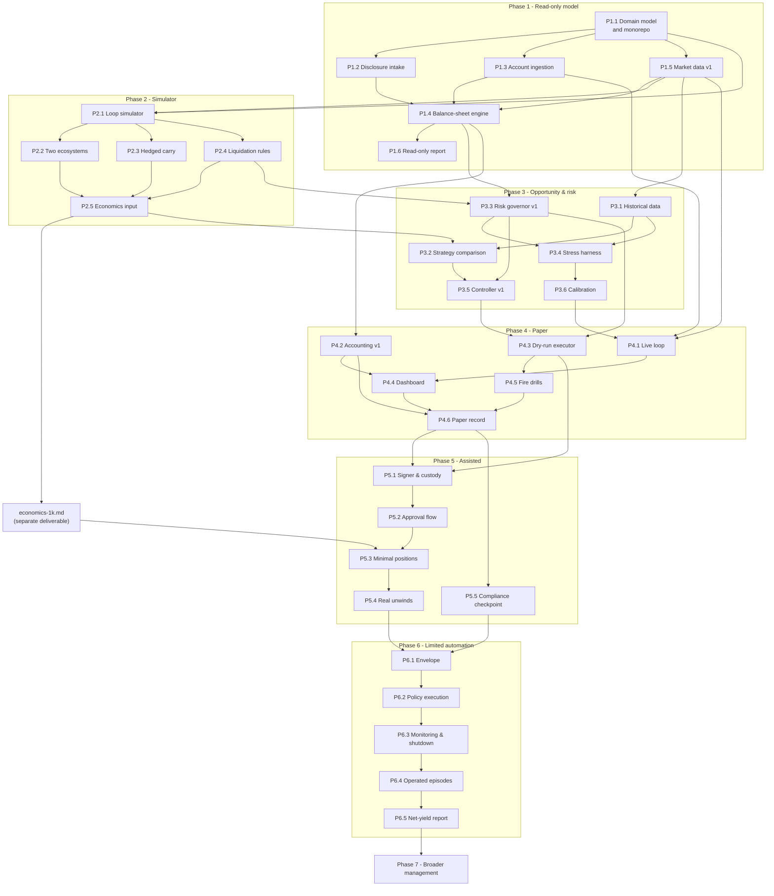

# Phased implementation plan

Spec deliverable §14.9. Maps the seven phases of spec §13 to milestones, deliverables, exit criteria, modules, and integrations. Related: [`architecture.md`](architecture.md), [`integrations.md`](integrations.md), [`risk-governor.md`](risk-governor.md).

Effort is described by the components and integrations that must change and by the verification required, not by calendar time. Each phase must be reliable before the next begins; **unrestricted autonomous deployment is never a phase.**

---

## 1. Current status

Work on Phases 1–3 has started in parallel because they are read-only, share one codebase, and do not depend on any write integration:

| Workstream | Scope | Where |
| --- | --- | --- |
| Balance-sheet model and simulator | TypeScript monorepo: shared domain types, balance-sheet engine (Phase 1 core), recursive collateral-loop simulator for two asset ecosystems (Phase 2), first strategy-comparison and stress-test harness (Phase 3 start) | `packages/`, `simulator/` (separate PR) |
| ~$1k economics assessment | Whether the loop clears the hurdle at seed scale once gas, swap slippage, venue minimums, bridging, and liquidation rules are included (spec §14.10) | `docs/economics-1k.md` with supporting data under `docs/data/` (separate PR) |
| Design documents | This plan, architecture, integrations inventory, risk governor specification (spec §14.1, 2, 8, 9) | `docs/` (this PR) |

The remaining initial deliverables (§14.3–7: balance-sheet model, simulator, strategy economics engine, agent CLI in place of a live dashboard, accounting ledger) are produced inside Phases 1–4 below.

---

## 2. Phase plan

Milestone ids are `P<phase>.<n>`. "Modules" use the names from `architecture.md` §5. "Integrations" reference `integrations.md` §1 row numbers.

### Phase 1 — Read-only financial model

**Objective.** Connect data sources, ingest disclosures, and build the consolidated balance sheet. No transactions.

| Milestone | Deliverable | Exit criterion |
| --- | --- | --- |
| P1.1 Domain model and monorepo foundation | Shared TypeScript types for accounts, assets with liquidity tiers, liabilities, collateral positions, ledger entries, snapshots; integer base-unit money type; test harness | Types compile and are used by at least two packages; property tests for money arithmetic |
| P1.2 Disclosure intake | Schema and import for income, expenses, debts, emergency savings, near-term cash needs, horizon, risk tolerance, tax residency, restrictions (§2B); deployable-capital calculation | Deployable capital and required reserve computed from a fixture profile; the entire bank balance is never treated as investable |
| P1.3 Account ingestion (read-only) | One aggregator adapter (Plaid or Teller) plus manual/CSV import; EVM wallet reads via RPC multicall and one portfolio indexer; venue account read (Hyperliquid Info) | Snapshots carry source, `asOf`, and freshness; per-Item rate limits respected; no write credential exists anywhere in the codebase |
| P1.4 Balance-sheet engine v1 | Consolidated balance sheet with liquidity tiers T0–T3, borrowed vs. owned split, contingent obligations, reserve adequacy, borrowing capacity under configured limits | Reconciles recorded snapshots to a fixture ledger with zero unexplained differences; runs fully offline from recorded snapshots |
| P1.5 Market data ingestion v1 | Aave reserve parameters, E-mode categories, rates; LST exchange rates; Chainlink feeds with staleness checks; CoinGecko/DefiLlama cross-checks | Two independent price sources per asset; stale/divergent flags raised in tests |
| P1.6 Read-only report | CLI or minimal page rendering the balance sheet, custody status per account (observed vs. managed), and data freshness | User can see what the platform can observe vs. manage (§2A) |

Modules: account & disclosure layer, balance-sheet engine, opportunity engine (read side), audit layer (event log v1), data store. Integrations: 1 or 2 (aggregator), 4 (fallback), 5, 6, 8, 10, 11, 12, 22, 25.

Risks: aggregator cost and rate limits; LST and protocol parameter drift (mitigated by reading everything live and pinning address-book commits).

### Phase 2 — Shadow-bank simulator

**Objective.** Model the recursive collateral-and-borrowing loop for at least two candidate asset ecosystems; compute leverage, net yield, equity, and liquidation risk at each step.

| Milestone | Deliverable | Exit criterion |
| --- | --- | --- |
| P2.1 Loop simulator core | Step-by-step model of supply → borrow → swap → re-supply with haircuts (LTV, LT, liquidation bonus), caps, borrow-rate curves, gas, slippage, venue minimums; incremental ROE and liquidation distance per step; optimal stopping point | Reproduces hand-computed cases; stopping point moves correctly when costs or rates change |
| P2.2 Two ecosystems | Parameter sets for (a) an ETH LST loop on Ethereum Core and (b) the same loop on an L2 (Arbitrum or Base); optional (c) a Solana LST loop if a Solana lending venue is prioritised | Both ecosystems run end-to-end from live-fetched and recorded parameters |
| P2.3 Hedged-carry extension | Add a short perpetual leg with funding, fees, margin, isolated-margin liquidation price, bridge cost and latency | Net carry = asset yield + funding − borrow − hedge − transaction costs, reported gross and net |
| P2.4 Liquidation and small-position rules | Aave v3.3 close-factor rules (100% below $2,000), Hyperliquid maintenance margin and backstop rules | Simulated liquidation outcomes match protocol rules in unit tests |
| P2.5 Economics assessment input | Scenario runs at $1k, $10k, $100k with current parameters feeding `economics-1k.md` | Report states, with assumptions, whether any configuration clears the hurdle at $1k, and at what size it would |

Modules: strategy engine (offline form), opportunity engine (history). Integrations: 10, 12, 14, 16 (SDK for data), 17–19 (exchange rates), 24.

Risks: parameters change under governance; venue minimums make sub-$1k hedges infeasible. Both are findings, not blockers.

### Phase 3 — Opportunity and risk engine

**Objective.** Compare strategies using current and historical data; implement reserves, risk limits, stress tests, and a no-deployment state.

| Milestone | Deliverable | Exit criterion |
| --- | --- | --- |
| P3.1 Historical data store | Rate, funding, price, utilization, and exchange-rate history for the candidate venues (Aave GraphQL/subgraph, Hyperliquid funding history, DefiLlama) | Backtests run over at least the stress windows listed in `risk-governor.md` §9.1 where data exists |
| P3.2 Strategy comparison engine | Expected net return, risk-adjusted return, absolute dollar contribution, minimum viable size, and data provenance per strategy; configurable hurdle (default 10% net); explicit "hold liquid" result | Produces "no strategy clears the hurdle" for a fixture where that is true; realized-vs-projected tracking schema in place |
| P3.3 Risk governor v1 (offline) | Metric definitions, state machine, hard limits, `evaluate` against simulated proposals, hysteresis and dwell times | All scenarios in `risk-governor.md` §9.1 produce the expected states and mandated actions in simulation; zero would-be liquidations in the base parameter set |
| P3.4 Stress-test harness | Scenario runner with recorded and synthetic shocks; reports minimum HF, would-be liquidations, time-to-safety, costs | Harness runs in CI against the simulator |
| P3.5 Portfolio controller v1 (offline) | Reserve-first allocation, repayment, compounding rules (compounding never raises leverage), proposal generation as `ActionIntent`s | Controller proposals pass or fail governor evaluation deterministically on fixtures |
| P3.6 Parameter calibration | Starting thresholds and limits reviewed against stress results; signed configuration format | Configuration v1 signed and versioned |

Modules: opportunity engine, strategy engine, risk governor, portfolio controller, audit layer. Integrations: 12, 13, 14, 24, 25.

Risks: incomplete historical data for L2 markets; over-fitting thresholds to past events (mitigated by synthetic scenarios).

### Phase 4 — Paper operation

**Objective.** Run the entire controller against live data without real transactions; track hypothetical NAV, debt, income, costs, drawdowns.

| Milestone | Deliverable | Exit criterion |
| --- | --- | --- |
| P4.1 Live ingestion loop | Continuous account and market ingestion with freshness SLOs; governor running as a separate process with its own feeds and RPC provider | Freshness SLOs in `risk-governor.md` §8.1 met for 30 consecutive days |
| P4.2 Accounting engine v1 | Double-entry ledger, NAV, realized vs. unrealized, net annualized yield, financing costs, drawdown; synthetic receipts from the dry-run executor | Ledger reconciles to the simulated positions daily; borrowed principal and transfers never counted as income |
| P4.3 Execution layer in dry-run mode | Transaction construction with official SDKs, mandatory simulation (local fork and `eth_simulateV1`), expected-post-state checks, synthetic receipts; Hyperliquid order construction against testnet | Every paper action has a simulated post-state within tolerance; testnet orders accepted |
| P4.4 Agent CLI (replaces live-data dashboard) | `pnpm sb` one-screen status plus balance-sheet, disclosures, sim, risk, strategy/accounting stubs; `--json` and veto exit codes | Agent can read NAV/equity/debt/reserves/HF/hurdle/action from `pnpm sb status --json`; no web UI |
| P4.5 Fire drills | Each unwind playbook executed in paper mode monthly; kill switch levels exercised | Drill reports in the audit log with time-to-safety |
| P4.6 Paper track record | Hypothetical NAV, debt, income, costs, drawdown, realized-vs-projected comparison | Three consecutive months with zero would-be liquidations and alert SLOs met (`risk-governor.md` §9.2) |

Modules: all ten plus signer stub (no keys), data store, agent CLI. Integrations: 5, 10, 12, 14, 15 (testnet), 16, 22, 24, 25, 26.

Risks: paper execution hides slippage and failed-transaction realities (mitigated by conservative cost assumptions and testnet orders).

### Phase 5 — Assisted execution

**Objective.** Propose specific actions for user approval; verify transaction construction, accounting, repayments, and unwind procedures with real but minimal positions.

| Milestone | Deliverable | Exit criterion |
| --- | --- | --- |
| P5.1 Custody and signer | Signer process or hardware/hosted KMS; EVM hot key as a role member of a smart account with allowlists and allowances; Hyperliquid API wallet with short expiry; secrets handling; out-of-policy transactions attempted and refused in tests | Attempted out-of-policy actions are refused at the signer and on-chain |
| P5.2 Approval flow | Intent-hash-bound, time-bound user approvals rendered with plain-language effect, post-state, and costs; no "approve all" | Every executed action has a matching approval in the audit log |
| P5.3 Minimal real positions | Smallest viable supply/borrow/repay/withdraw cycle on the chosen L2; smallest viable hedge open/adjust/close on Hyperliquid mainnet; swaps via Universal Router with slippage caps | Accounting matches on-chain and venue state to the unit; all costs recorded |
| P5.4 Real unwinds | Each playbook executed with the minimal positions, including flash-loan unwind if applicable | Time-to-safety and cost recorded; no step relied on T2 liquidity |
| P5.5 Compliance and disclosure checkpoint | Assessment of registration, licensing, custody, lending, derivatives, consumer-protection, privacy, tax, and sanctions implications for the user's jurisdiction (§12); UI disclosures of custody status, risks, and the ability to pause or terminate | Written assessment accepted by the user before any real deployment beyond test size |

Modules: execution layer, signer, user interface (approvals), accounting (real receipts), audit. Integrations: 9, 15, 17, 21, 26, 28, 29 (user-performed on-ramp), optionally 27.

Risks: smart-account and role-modifier complexity; venue minimums ($10 order) making "minimal" hedges relatively large versus a $1k book.

### Phase 6 — Limited automation

**Objective.** Deploy only a small authorized allocation with hard-coded limits, independent risk controls, monitoring, and an emergency shutdown.

| Milestone | Deliverable | Exit criterion |
| --- | --- | --- |
| P6.1 Authorized envelope | Signed envelope: USD cap (initially the seed, ≤ $1,000), allowed strategies, venues, networks, limits (Phase 6 caps from `risk-governor.md` §4: 2.0× correlated, 1.5× uncorrelated) | Signer and on-chain allowances match the envelope exactly |
| P6.2 Policy-approved execution | Actions inside the envelope execute without per-action approval; anything outside, any loosening, and large loss-realizing unwinds require approval; time-locked configuration changes | Attempted outside-envelope actions are refused; time lock proven |
| P6.3 Independent monitoring and shutdown | Governor and signer heartbeats, dead-man's switch, out-of-band kill switch, standing risk-reducing actions at the venue | Kill switch levels tested live; governor outage leads to fail-closed behavior in a live test |
| P6.4 Operated episodes | The envelope operated through at least one Caution and one Deleveraging episode (real or drilled) with correct behavior and complete audit trails | Post-mortems filed; parameters reviewed |
| P6.5 Net-yield reporting | Consolidated net yield after all costs reported against the hurdle, realized separated from projected, with assumptions | Report reviewed by the user; decision recorded whether to continue, pause, or expand |

Modules: all. Integrations: as Phase 5 plus 7 (optional cross-check), 23 (not expected to be needed).

Risks: the economics may show that a $1k envelope cannot clear the hurdle after costs; the correct outcome is then to hold liquid and document it, not to add leverage.

### Phase 7 — Broader management

**Objective.** Expand strategies and automation only after reliable accounting, execution, and risk handling have been demonstrated.

| Milestone | Deliverable | Exit criterion |
| --- | --- | --- |
| P7.1 Envelope expansion | Larger USD cap and the concentration limits that phase in above $25k | Each increase preceded by a review of Phase 6 metrics and a fire drill |
| P7.2 Additional strategies | Liquidity provision (with loss-versus-rebalancing model and hedge), additional venues (e.g., Aave v4 spokes), additional LSTs; each must satisfy the §4F criteria: mechanism, verifiable data, measurable costs, risk model, entry/exit, programmatic execution | Strategy admitted only after simulator, stress tests, paper run, and assisted execution for that strategy |
| P7.3 Multi-network and multi-venue risk | Bridge risk, sequencer risk, cross-venue margin logistics in the governor | Scenarios added to the stress set and passed |
| P7.4 Tax lots and reporting | Lot tracking and estimated tax liabilities where supported (§8) | Reports reconcile with the ledger |
| P7.5 Operational maturity | Runbooks, incident process, key rotation schedule, backup/restore of the data store, periodic security review | Reviews completed and logged |

Modules: all. Integrations: 7, 13, 21 (LP), 23 as needed, plus new candidates evaluated through the Phase 2–5 pipeline.

---

## 3. Dependency graph

Critical path: domain model → balance-sheet engine → risk governor v1 → stress calibration → live loop → paper record → signer → minimal real positions → envelope. The economics assessment gates Phase 5 real positions: if it shows the loop cannot clear the hurdle at seed scale, Phase 5 still proceeds with minimal test positions (to verify execution and unwinds) but Phase 6 may conclude with the "hold liquid" outcome.

---

## 4. Cross-cutting workstreams

| Workstream | Runs during | Content |
| --- | --- | --- |
| Security | All phases; hard gate before Phase 5 | Secret handling, dependency pinning, signer isolation, allowlist and allowance design, key rotation, threat model review per phase |
| Compliance and disclosures | Checkpoint in Phase 5 (P5.5), reviewed each phase after | Jurisdictional assessment (§12); UI disclosures of custody, risks, and pause/terminate controls; no promised yields anywhere in product copy |
| Data quality | From Phase 1 | Two sources per price, freshness flags, provenance on every record, divergence alarms |
| Testing | From Phase 1 | Unit and property tests for money math and protocol rules; simulator regression fixtures; stress harness in CI; fork-based integration tests for execution; chaos tests for governor/signer outages (Phase 4+) |
| Observability | From Phase 4 | Metrics, alert channels, dashboards, audit-log integrity checks |
| Documentation | Continuous | Keep `integrations.md` limits and the governor's starting values re-verified at each phase gate; record decisions in the audit log and in `docs/` |

---

## 5. Decision gates

Each phase ends with a written gate review recorded in the audit log and in `docs/`:

1. Exit criteria for every milestone met, with evidence links.
2. Integration limits and protocol parameters re-verified (dated).
3. Risk parameters reviewed; loosening only through the time-locked path.
4. Open risks listed with owners.
5. Explicit user decision: proceed, hold, or roll back.

A gate may conclude that the economics do not justify the next phase. That is a valid outcome; the system's job includes concluding that no strategy is attractive enough (§5).

---

## 6. Open decisions carried from the architecture

| Decision | Needed by | Notes |
| --- | --- | --- |
| Aggregator choice (Plaid vs. Teller vs. manual) | P1.3 | Teller is cheaper but lacks investments; Plaid covers brokerages |
| Second ecosystem for the simulator (L2 Aave market vs. Solana) | P2.2 | Solana requires a separate stack; an L2 market is the default |
| Hedging venue network path (bridge USDC from Arbitrum) and margin buffer size | P2.3 / P5.3 | Drives the pre-funded margin requirement in the reserve |
| Signer implementation and smart account | P5.1 | Safe + Roles v2 vs. hosted KMS policy engine |
| Aave v3 vs. v4 for first real positions | P5.3 | v3 L2 markets are the default; v4 evaluated once caps and liquidity mature |
| Audit log anchoring | P4.1 | Object-storage digests vs. on-chain |
