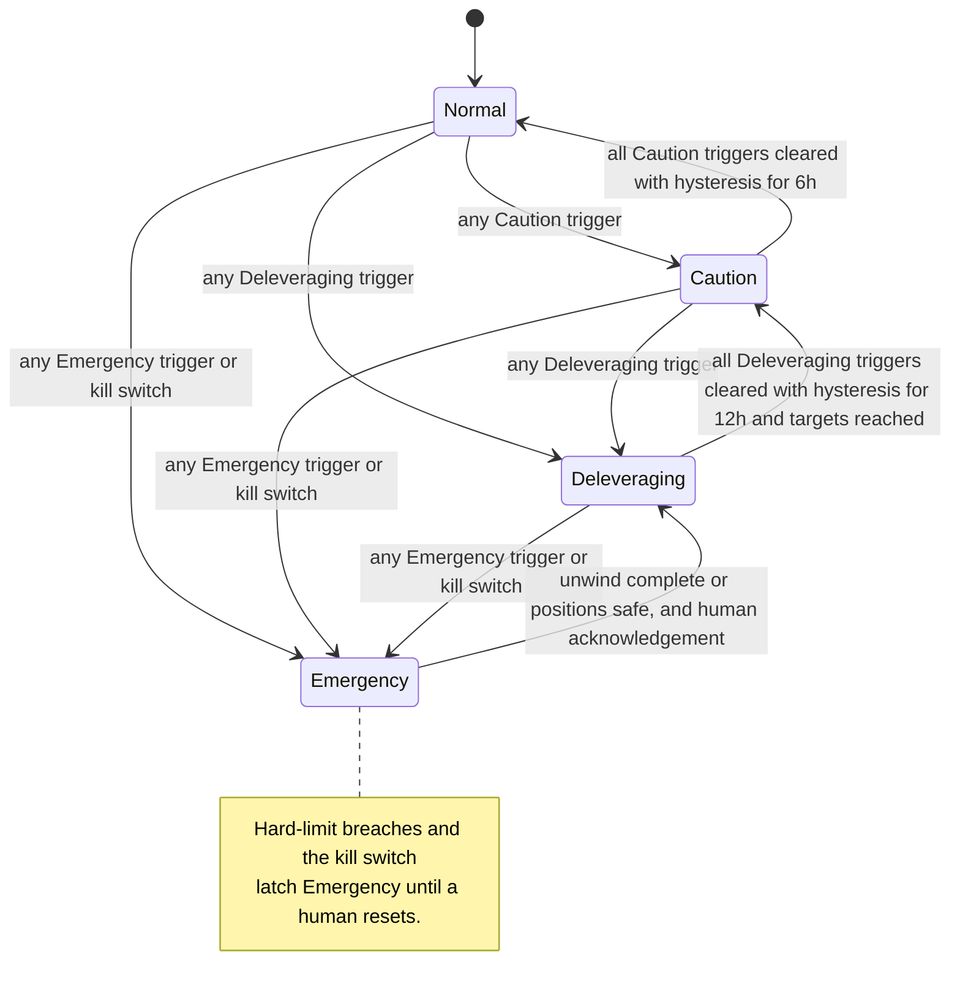
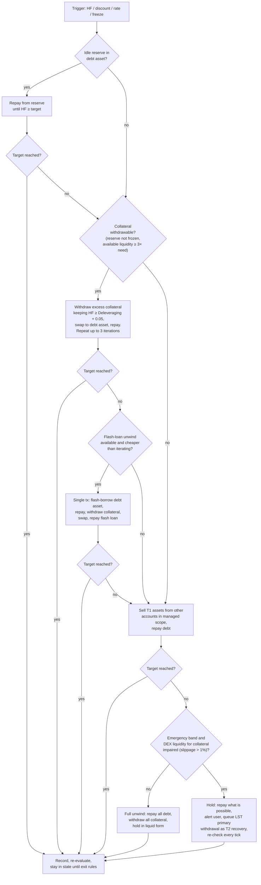
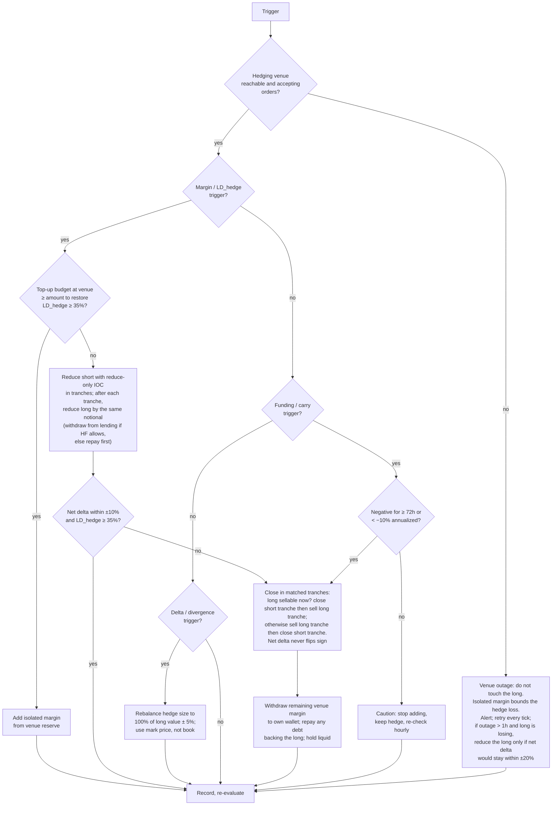

# Risk governor and emergency-action specification

Spec deliverable §14.8, implementing spec §7 (and the execution controls of §11). Architecture context: [`architecture.md`](architecture.md) §4–5; venue mechanics: [`integrations.md`](integrations.md) §3.

**Governing principle: survival over yield.** The governor exists to keep the balance sheet solvent, liquid, and recoverable under stress. It never increases risk on its own. When in doubt it blocks. A missed opportunity is recoverable; a liquidation or a drained wallet is not.

All numeric values in this document are **proposed starting values** for simulation (Phase 2–3) and the first paper run (Phase 4). They must be calibrated against the stress scenarios in §9 before any real-money phase, and every change is versioned and signed (§7.7).

---

## 1. Authority and scope

| Property | Specification |
| --- | --- |
| Authority | The governor evaluates every `ActionIntent` before execution and may **approve**, **approve with reduced size**, or **reject**. In Deleveraging and Emergency it **mandates** risk-reducing intents that bypass the strategy engine and portfolio controller. Nothing it rejects can be executed by any other component, including the AI layer and the user interface. |
| What it cannot do | It cannot originate risk-increasing actions, cannot bypass the signer's allowlists or spending limits, cannot move funds to any address other than the user's own, and cannot change its own hard limits. |
| Independence | Separate process, separate database role, its own subscriptions to balance and market data (not the strategy engine's snapshots), its own RPC provider distinct from the executor's. |
| Availability | If the governor is unreachable, the executor **fails closed**: no risk-increasing action is signed. Pre-authorized standing risk-reducing actions (stop-loss style, §6.5) continue to be honored by the signer. |
| Scope at seed scale | Covers every managed account: lending collateral positions, perpetual hedges, LP positions, reserves, and the hot wallets' native-gas balances. Observed-only accounts feed reserve and concentration metrics but trigger no actions. |

Two interfaces (see `architecture.md` §2.1):

- `evaluate(proposal) → Authorization[] | Rejection` — synchronous pre-trade check.
- `tick(snapshot) → RiskState, MandatedIntent[]` — continuous monitoring and state machine, run on every new snapshot and at least every 60 s.

---

## 2. Monitored metrics

Every metric carries `asOf`, `source`, and a `quality` flag (`fresh`, `stale`, `divergent`, `missing`). A metric with quality other than `fresh` is treated as a breach of its **most conservative** threshold for the purpose of risk-increasing decisions, and as unknown (no automatic risk-reducing action beyond Caution) for risk-reducing decisions unless corroborated by a second source.

| Metric | Definition | Primary source | Refresh |
| --- | --- | --- | --- |
| **Gross leverage** `L` | Gross assets ÷ equity, where gross assets include collateral and hedge margin at fair value and equity = NAV | Balance-sheet engine (governor recomputes) | Every snapshot |
| **Loan-to-value** `LTV` | Total debt ÷ total collateral value, per venue and consolidated | Protocol view contracts, venue account state | Every snapshot |
| **Health factor** `HF` | Σ(collateral value × liquidation threshold) ÷ debt, using the **protocol's own oracle** (lending venue) | Lending protocol (`getUserAccountData` / `UiPoolDataProvider`) | Every block or ≤ 30 s |
| **Liquidation distance (lending)** `LD_lend` | Relative adverse price move of the collateral basket (holding debt constant) that brings HF to 1: `1 − 1/HF` for single-collateral/stable-debt positions; for correlated (E-mode) positions the relevant move is the **exchange-rate discount** of the LST versus the debt asset | Derived | Every snapshot |
| **Liquidation distance (hedge)** `LD_hedge` | Relative adverse price move to the venue's liquidation price, computed with the venue's published formula and margin tiers; isolated positions use isolated margin only | Venue account state and `meta` margin tables | Real time (WebSocket) |
| **Margin ratio** | Maintenance margin required ÷ isolated margin remaining for the hedge position (venue-reported cross-check of `LD_hedge`) | Venue | Real time |
| **Net delta** | Signed exposure to the hedged asset after netting long collateral and short hedge, as % of the hedged notional | Derived | Every snapshot |
| **Net directional exposure** | Net exposure to non-stable assets (long collateral − short hedges − debt in the same asset) as % of NAV | Derived | Every snapshot |
| **Collateral and debt volatility** | Realized 30-day and 7-day annualized volatility of each collateral and debt asset, and of LST exchange rates | Price history | Hourly |
| **Borrow-rate** | Current variable APR, 24 h change, 7-day average, reserve utilization, distance to the rate-curve kink | Lending protocol | ≤ 5 min |
| **Funding-rate** | Current hourly funding, 24 h and 7-day averages, sign and sign-flip count | Hedging venue | Hourly |
| **Net carry** | Asset yield + funding received − borrow cost − hedge cost − amortized transaction costs, annualized, per strategy | Strategy engine inputs, recomputed | Hourly |
| **Concentration** | Share of gross assets by asset, protocol, network, and issuer (for LSTs) | Balance sheet | Every snapshot |
| **Stablecoin peg** | Deviation of each held or borrowed stablecoin from 1.00 (median of ≥ 2 sources) | Oracle + market data | ≤ 1 min |
| **Oracle integrity** | Staleness of each feed vs. its heartbeat; divergence between the protocol oracle and an independent reference; L2 sequencer uptime status | Chainlink feeds, protocol oracle, venue mark/oracle | Every block |
| **Protocol utilization & withdrawal liquidity** | Reserve utilization; available liquidity ÷ our supplied amount; LST primary-queue length; venue withdrawal status | Protocol / venue | ≤ 5 min |
| **Smart-contract / protocol status** | Pause flags, frozen reserves, governance actions in flight that change our reserves' parameters, security incident feeds | Protocol, governance, incident feeds | ≤ 15 min |
| **Counterparty & operational** | RPC provider health and disagreement, data freshness per source, signer heartbeat, executor queue age, pending tx age, native-gas balances per chain | Internal | ≤ 1 min |
| **Drawdown** | NAV ÷ high-water-mark NAV − 1 (realized + unrealized), since inception and rolling 30 d, measured in base currency against the configured **benchmark exposure** (default: base-currency cash; see note under §3.1) | Accounting | Every snapshot |
| **Daily P&L** | Change in NAV over the current UTC day excluding deposits/withdrawals, measured against the same benchmark | Accounting | Every snapshot |
| **Reserve coverage** `RC` | Liquid reserve held (T0 + haircut T1) ÷ required reserve (from disclosures: upcoming expenses, buffer, margin top-up budget) | Balance sheet | Every snapshot |

---

## 3. Risk states

Four states from §7. Transitions are evaluated on every `tick`. **Entry** is triggered when **any** listed condition holds (worst-of). **Exit** to a lower state requires **all** entry conditions of the higher state to clear by the hysteresis margin **and** a minimum dwell time, so the system does not oscillate. Transitions upward can skip states; transitions downward go one state at a time.

### 3.1 Thresholds

Lending-side thresholds are given for two position classes because E-mode correlated pairs (e.g., an ETH LST against ETH) carry exchange-rate risk rather than full price risk, while uncorrelated pairs (e.g., ETH collateral, stablecoin debt) carry full price risk. The governor classifies each collateral position using the protocol's E-mode category and the realized correlation of the pair.

| Metric | Normal (operate) | Caution (entry) | Deleveraging (entry) | Emergency (entry) | Exit hysteresis |
| --- | --- | --- | --- | --- | --- |
| HF, uncorrelated class | ≥ 1.60 | < 1.60 | < 1.35 | < 1.15 | +0.10 above the entry value |
| HF, correlated (E-mode) class | ≥ 1.25 | < 1.25 | < 1.12 | < 1.05 | +0.04 above the entry value |
| `LD_lend`, uncorrelated | ≥ 37% | < 37% | < 26% | < 13% | +3 pts |
| LST exchange-rate discount (correlated class) | < 1.0% | ≥ 1.0% | ≥ 3.0% | ≥ 6.0% | −0.5 pts |
| `LD_hedge` (isolated short; ≈ 47% at the 2× entry leverage cap with a 2% maintenance rate) | ≥ 35% | < 35% | < 25% | < 15% | +5 pts |
| Margin ratio (maintenance ÷ isolated margin remaining; the bands below are the `LD_hedge` bands restated for 2× entry leverage and a 2% maintenance rate, recomputed per asset tier) | ≤ 5% | > 5% | > 7.5% | > 12% | −1 pt |
| Net delta vs. hedged notional | within ±5% | outside ±5% for > 1 h | outside ±10% for > 1 h | outside ±20% | back inside the Normal band |
| Net directional exposure vs. NAV | ≤ user's exposure budget (default 100%) | > budget | > budget + 10 pts | > budget + 25 pts | ≤ budget − 5 pts |
| Net carry (per strategy) | > 0 after costs | ≤ 0 for 24 h | ≤ 0 for 72 h, or < −5% annualized | — | > hurdle ÷ 2 for 24 h |
| Borrow-rate | APR < expected asset yield + 2 pts | APR ≥ asset yield + 2 pts, or utilization ≥ 90% | utilization ≥ 97%, or APR ≥ 2× asset yield for 24 h | — | utilization < 85% |
| Funding (hedged carry, short leg) | 7-day avg ≥ 0 | 7-day avg < 0 | 7-day avg < −10% annualized | — | 7-day avg > 0 |
| Stablecoin peg (held or borrowed) | within ±0.5% | beyond ±0.5% | beyond ±2% | beyond ±5% | inside ±0.3% for 6 h |
| Oracle integrity | fresh, divergence < 1% | stale > heartbeat + 10 min, or divergence ≥ 1%, or sequencer down < 1 h | divergence ≥ 3% | divergence ≥ 5%, or sequencer down ≥ 1 h with HF in Caution band | fresh for 30 min |
| Withdrawal liquidity (lending reserve) | available liquidity ≥ 10× our supply | < 10× | < 3×, or reserve frozen/paused | reserve paused with HF in Caution band | ≥ 15× |
| Reserve coverage `RC` | ≥ 1.0 | < 1.0 | < 0.75 | < 0.5 | ≥ 1.1 |
| Daily P&L | > −2% NAV | ≤ −2% | ≤ −4% | ≤ −6% (hard limit) | new UTC day and no other trigger |
| Drawdown from HWM | > −5% | ≤ −5% | ≤ −10% | ≤ −15% (hard limit, latched) | drawdown recovers 2 pts above the entry value |
| Operational | all sources fresh, signer healthy | any source stale > 10 min, pending tx > 30 min | governor's two RPC providers disagree on balances, or signer unreachable > 15 min | data loss > 1 h while any position is in Caution band | healthy for 30 min |
| Protocol status | no flags | governance proposal in flight that reduces LT/LTV on our reserves, or incident reported on a connected protocol | reserve frozen for withdrawals, or exploit confirmed on a connected protocol | exploit confirmed on the protocol holding our collateral | human review |

**Note on benchmark exposure.** Drawdown and daily-loss limits are measured on NAV in the user's base currency. An unhedged yield-bearing-collateral loop (for example an ETH LST against ETH debt) is, after netting, a roughly 1× long position in the underlying asset plus a leveraged exposure to the LST's exchange rate; with the default base-currency-cash benchmark the drawdown limits will be reached in ordinary volatility of that asset, and the mandated response is to remove leverage and derivative exposure, then hold in the form the user's disclosed policy specifies (cash-equivalent by default). This is intended: at seed scale an unhedged loop is a leveraged directional position and the governor treats it as one. A user who would hold the underlying asset regardless can configure that asset as the benchmark, in which case the limits measure only the strategy's excess return and the exposure budget caps the unhedged position at the benchmark holding. Either way the choice is an explicit, signed configuration, never a default inferred by the system.

### 3.2 Permitted actions per state

| Action class | Normal | Caution | Deleveraging | Emergency |
| --- | --- | --- | --- | --- |
| Open new strategy / increase leverage | Yes, within limits | **No** | No | No |
| Rebalance within a strategy (hedge ratio, range) | Yes | Yes, risk-neutral only | Only if it reduces risk | Only as part of the unwind plan |
| Compound retained earnings into productive assets | Yes, if post-action HF/LD remain Normal | No; retain in liquid form | No | No |
| Add collateral / add margin from reserve | Yes | Yes (preferred first response) | Yes, mandated | Yes, if it is the cheapest route to safety |
| Repay debt / reduce hedge | Yes | Yes | **Mandated** to targets | Mandated |
| Raise liquidity (sell T1 assets) | By controller | Encouraged | Mandated to restore `RC ≥ 1` | Mandated |
| Full unwind to liquid form | By user | By user | If targets cannot be reached within the time budget | **Default plan** (§6) |
| Withdraw to user's external account | User-approved | User-approved | User-approved | User-approved |
| Change governor parameters to loosen | Signed + time-locked | Signed + time-locked | Not allowed | Not allowed |

Targets when entering **Deleveraging**: restore every metric to its Normal band with a 10% margin within a time budget of 4 hours (extended automatically if markets are impaired and the action itself would be more dangerous than waiting; the extension is logged and alerts the user). Entering **Emergency** replaces targets with the unwind playbook of §6; the objective becomes "no leverage, no derivative exposure, maximum liquid form reachable with the available liquidity," subject to the cost rule in §6.1.

---

## 4. Hard limits

Hard limits are absolute. A proposal that would breach one is rejected regardless of state; a limit breached by market movement triggers the state in the last column. Limits are enforced redundantly: in the governor (`evaluate`), in the signer (allowlists and spending limits), and where possible on-chain or venue-side.

| Limit | Starting value | Rationale | Enforced in | Breach → |
| --- | --- | --- | --- | --- |
| Maximum gross leverage, correlated (E-mode) loop | **3.0×** (Phase 6 initial cap **2.0×**) | At 3.0× with a 95% liquidation threshold HF ≈ 1.43; a 10% LST discount leaves HF ≈ 1.28, still inside Normal. The protocol would allow > 10×; the product deliberately does not. | Governor, simulator | Deleveraging |
| Maximum gross leverage, uncorrelated | **2.0×** (Phase 6 initial cap **1.5×**) | At 2.0× with an 80–83% LT, HF ≈ 1.6–1.66 and `LD_lend` ≈ 37–40%; survives the largest one-day ETH drawdowns in the scenario set with margin. | Governor | Deleveraging |
| Net directional exposure to non-stable assets | **≤ 100% of NAV** by default (the user's exposure budget, set from disclosed risk tolerance; may be lower, never higher than 100%) | The platform may hold productive assets up to the user's equity but never a leveraged-long position in base-currency terms; leverage is for yield on collateral, not for amplifying price exposure. | Governor | Deleveraging |
| Maximum recursive loop steps | **3** | Marginal ROE per step decays while gas and slippage per step do not; beyond 3 steps at seed scale the costs exceed the incremental income (to be confirmed by the economics assessment). | Governor, strategy engine | Reject |
| Minimum post-action HF | Normal threshold **+ 0.15** (uncorrelated) / **+ 0.05** (correlated) | New actions must land inside Normal with a buffer, not at its edge. | Governor | Reject |
| Position size — authorized allocation | **100% of the authorized envelope, which is itself capped in USD** (Phase 6 initial envelope: the seed, ≤ $1,000; raised only by signed config) | Spec §13 Phase 6: "only a small authorized allocation." Concentration limits are meaningless at one venue; the absolute cap is the real control. | Governor, signer spending limit, on-chain allowance | Reject |
| Position size — single strategy | ≤ **100%** of the envelope at seed scale; ≤ **50%** once the envelope exceeds $25k | Diversify only when there is enough capital for two strategies to each clear minimum sizes. | Governor | Reject |
| Protocol concentration | No limit below $25k envelope (single venue expected); ≤ **60%** of gross assets per protocol above $25k; ≤ **40%** above $250k | Phased in with scale; at seed scale the leverage and HF limits bind. | Governor | Caution, then Deleveraging if > limit + 10 pts |
| Network concentration | ≤ **80%** per network above $25k | Bridge and sequencer risk. | Governor | Caution |
| Single non-stable asset | ≤ **70%** of gross assets above $25k (an ETH LST plus ETH debt counts once as ETH) | Issuer and depeg risk of LSTs. | Governor | Caution |
| Hedge notional | **≤ 100% of the hedged long's value + 5%**; hedge positions use **isolated margin only**; venue leverage setting ≤ **2×** | Never net short; isolate so a hedge liquidation cannot touch other margin; 2× entry leverage with a 2% maintenance rate gives `LD_hedge` ≈ 47% at entry, inside the Normal band with room for a rally before Caution. | Governor, executor order construction | Reject / reduce |
| Daily loss | **−6% NAV** → Emergency (latched); −4% Deleveraging; −2% Caution | Scaled to the strategies' expected volatility; a 6% day on a ≤ 3× correlated book implies a market event where discretion is wrong. | Governor | Emergency |
| Maximum drawdown | **−15% from HWM** → Emergency unwind, latched until human reset; −10% Deleveraging; −5% Caution | Capital preservation mandate (§7). | Governor | Emergency |
| Minimum liquidity reserve | **≥ 10% of deployable capital** in T0/T1 plus the disclosed near-term cash needs and a hedge margin top-up budget (≥ 30% of hedge margin), configurable in the 10–30% band of §6 | Spec §6 starting assumption; the hedge budget exists because margin cannot be moved cross-venue quickly. | Governor, controller | Caution < 1.0, Deleveraging < 0.75 |
| Per-transaction value | ≤ **envelope × 50%** and ≤ a USD cap per intent kind (Phase 6: $1,000 any single tx) | Limits blast radius of a bad transaction. | Signer, on-chain allowance | Reject |
| Per-day outflow / spend | ≤ **envelope × 100%** per UTC day for protocol interactions; **0** to any address that is not the user's own | Spending limit with daily refill. | Signer, on-chain allowance | Reject |
| Max slippage per swap | **0.5%** vs. reference price (1.0% during Deleveraging/Emergency; price-impact check also against on-chain quote) | At seed scale costs dominate; slippage above this means impaired liquidity, which itself is a signal. | Executor, governor | Reject |
| Max execution cost per action | Gas + fees ≤ **1%** of the action's notional (waived for Emergency actions) | Prevents fee-bleed loops on mainnet at small size. | Governor | Reject |
| Data staleness for risk-increasing actions | **≤ 2 min** for prices and positions; ≤ 15 min for rates | Stale data must block new risk. | Governor | Reject |
| Aave small-position rule | While total collateral or debt on a venue is **< $2,000**, treat the position as **100% liquidatable** at HF < 1 and require an extra **+0.10 HF** buffer on every threshold | Aave v3.3+ raises the close factor to 100% below $2,000 (`integrations.md` §3.1). | Governor | — |

---

## 5. Veto and override semantics

### 5.1 Pre-trade evaluation (`evaluate`)

For each `ActionIntent` in a proposal, in order:

1. **Authentication and scope.** The intent targets an allowlisted venue, contract, asset, and account in the managed scope; recipients are the user's own addresses.
2. **State gate.** The intent's action class is permitted in the current risk state (§3.2).
3. **Hard limits.** The simulated post-state (recomputed by the governor from its own data, using the proposal's expected post-state only as a cross-check) satisfies every limit in §4 including the post-action HF buffer and the small-position rule.
4. **Liquidity rules (§6 of the spec).** The post-state keeps `RC ≥ 1.0`, does not rely on T2/T3 assets for reserves, and does not assume collateral can be withdrawn immediately.
5. **Economics sanity.** Expected net return after all costs clears the configured hurdle and the action's execution cost is within limit; otherwise the correct decision is "hold liquid."
6. **Data quality.** All inputs `fresh`; otherwise reject risk-increasing intents.
7. **Decision.** `Approve` with an `Authorization` (intent hash, parameters, risk state, expiry ≤ 10 min for market-sensitive actions, governor signature); `ApproveModified` with a reduced size that satisfies the limits (never an increased size, never a different venue or asset); or `Reject` with machine-readable reasons.

A proposal is evaluated atomically: if any intent that later intents depend on is rejected, dependent intents are rejected too. Partial approvals are only issued for independent intents.

### 5.2 Post-trade re-evaluation

After each receipt the governor recomputes metrics. If the realized post-state breaches a Normal threshold (slippage, price move during execution), it cancels the remaining intents of the proposal and, if needed, mandates a corrective risk-reducing intent.

### 5.3 Mandated actions

In Deleveraging and Emergency, the governor emits its own `ActionIntent`s (repay, withdraw-to-repay, reduce hedge, add margin from reserve, sell T1 to raise liquidity, full unwind). These:

- carry the same `Authorization` structure, signed by the governor;
- are still subject to the signer's allowlists and spending limits (the governor cannot exceed them; if an unwind needs more than the daily spend limit the signer's **emergency lane** applies, which allows only repayments, withdrawals to the user's own addresses, and position reductions, with its own cap);
- pre-empt any pending strategy proposal, which is cancelled;
- are executed in the order of the playbook (§6), each simulated and verified like any other action;
- in **Phase 5** require user approval like everything else but are presented first with a countdown; in **Phase 6** repay/reduce/add-margin actions are pre-authorized by the user as part of the envelope, while a full unwind that would realize a loss above a configured amount notifies the user and proceeds after a short grace period unless the user pauses it (a pause is itself logged and keeps the system in Emergency).

### 5.4 Priority and conflicts

Order of precedence: **kill switch** > governor-mandated action > user approval/denial of a strategy proposal > portfolio controller proposal > AI suggestion. The strategy engine and controller cannot cancel or delay a mandated action. The user can always **pause** (which halts new risk and lets mandated risk-reducing actions complete unless the user explicitly halts them too, acknowledging the liquidation risk in the UI), and can always **withdraw to own accounts** subject to the same simulation and allowlist rules.

### 5.5 Overrides of the governor

- **Loosening** any threshold or limit requires a signed configuration change by the user's key, a **24-hour time lock** before activation, and an audit event; it is refused while in Deleveraging or Emergency.
- **Tightening** takes effect immediately.
- **Manual Emergency reset** requires the user's signed acknowledgement after the unwind has completed or positions are demonstrably safe for 12 h; the acknowledgement records the reason.
- There is **no override that lets the AI layer, the strategy engine, or the UI bypass an evaluation**. The only way to execute something the governor rejects is to change the configuration through the time-locked path and re-propose.

### 5.6 Governor failure

Watchdog: the signer requires a governor heartbeat no older than 5 min and a valid governor signature on every request. Without them it signs **only** pre-authorized standing risk-reducing actions (§6.5). The audit layer alerts on governor silence within 2 min.

---

## 6. Emergency unwind playbooks

### 6.1 Common rules

1. **Order of preference** for restoring safety: use idle reserve (repay debt / add margin) → withdraw excess collateral and repay → reduce positions in matched pairs → sell T1 assets → full unwind. Cheaper and less market-dependent routes first.
2. **Cost rule.** Prefer the route whose expected cost (fees, slippage, realized loss) is lowest **given it reaches the target within the time budget**; never choose a slower cheaper route if the faster route is the only one that keeps HF above the Emergency threshold at current volatility.
3. **Never depend on T2 liquidity** (LST primary withdrawal queues, unbonding) to resolve an acute threat; it is used only to complete an unwind after the acute threat is resolved.
4. **Matched tranches.** When both a long and a hedge exist, reduce them in tranches so net delta stays within ±10% and never flips sign; hedge first only when the long can be sold immediately afterwards, long first only when the hedge can be closed immediately afterwards.
5. **Gas and venue reserves.** Keep native gas on every chain for at least 10 emergency transactions at 3× current base fee, and hold the hedge-margin top-up budget at the venue.
6. **Every step is simulated** and must pass the signer's checks; if a step fails, fall to the next route, log, and alert.
7. **Fire drills.** Each playbook is executed end-to-end in paper mode (Phase 4) at least once per month and with a minimal real position (Phase 6) before the envelope is increased.
8. **Partial self-liquidation is not an action**; the playbooks aim to avoid liquidation entirely because at seed scale a liquidation takes 100% of the position (see §4, small-position rule).

### 6.2 Recursive collateral loop (e.g., LST collateral, ETH or stablecoin debt)

Triggers: HF or `LD_lend` in Deleveraging/Emergency band; LST discount; borrow APR spike; reserve frozen; oracle divergence; drawdown or daily-loss limit.

Step details:

| Step | Preconditions | Checks | Fallback |
| --- | --- | --- | --- |
| Repay from reserve | Reserve holds the debt asset (or a stable swappable within slippage limit) | Post-state HF ≥ target; `RC` after repayment ≥ 0.5 (reserve may be spent in emergency, but not to zero) | Next step |
| Withdraw-swap-repay loop | Reserve not paused; available liquidity ≥ 3× withdrawal; LST DEX depth supports the swap within slippage limit | Each iteration simulated; HF never dips below Deleveraging threshold mid-sequence | Flash-loan route or sell T1 |
| Flash-loan unwind | Flash loan available for the debt asset on the same venue; total cost (premium + swap + gas) < iterative route cost | Atomic; reverts leave state unchanged | Iterative route |
| Sell T1 assets | T1 assets exist outside the position (e.g., ETH or stables in other managed wallets) | Slippage ≤ 1%; concentration not worsened | Full unwind / hold |
| Full unwind | Any of the above succeeded enough to make the remainder safe, or Emergency | Final state: zero debt on venue, collateral withdrawn, assets in T0/T1 | Hold with alerts |
| Hold + queue primary withdrawal | DEX exit impaired (LST discount with thin books) | Debt reduced as far as possible; HF monitored every tick; primary withdrawal requested for the amount not needed as collateral | Human escalation |

Specific scenarios:

- **Borrow APR spike / utilization near cap.** Carry turns negative but HF is fine: Deleveraging via repay-from-reserve and withdraw-swap-repay to bring leverage to 1× (no debt). Do not race to withdraw collateral from a 100%-utilized reserve; repay instead.
- **Reserve frozen or paused.** Supplies cannot be withdrawn; repayment usually still works. Repay from reserve and T1 sales; do not attempt withdrawals until the flag clears.
- **Oracle divergence.** If the protocol oracle prices collateral lower than the market (risk of unfair liquidation), repay pre-emptively to the Emergency-safe HF using reserve; if it prices higher (HF looks better than it is), treat the market price as truth for all decisions.
- **Governance change lowering LT on our collateral.** Treat the proposal's effective date as the deadline to bring HF under the new parameters into Normal; deleverage ahead of execution.

### 6.3 Hedged carry (long yield-bearing asset, short perpetual)

Triggers: `LD_hedge` or margin ratio in band; funding 7-day average negative; net carry negative; net delta outside band; venue outage; bridge delay; mark/oracle divergence; drawdown limits.

Rules specific to this playbook:

- **Margin is pre-funded.** Because collateral cannot move from the lending venue to the hedging venue quickly (bridge + deposit), a top-up budget of at least 30% of the hedge's initial margin is kept at the venue and counted in the required reserve. It is the first response to margin pressure.
- **Isolated margin only, 2× entry leverage.** A backstop liquidation of an isolated short loses that position's margin and nothing else; the long remains and is then unhedged, which is why the next step is to reduce the long. Entering at 2× means roughly half the hedge notional sits as margin at the venue; this capital is part of the strategy's cost of carry and is counted in the economics assessment.
- **Reduce-only, IOC, size-capped orders** for all emergency reductions; minimum order value at the venue ($10) sets the tranche floor, so at seed scale tranches may be the whole position.
- **Funding reversals** are a slow signal; the 72-hour rule avoids whipsaw closing on a single negative day, while the −10% annualized rule closes faster on a severe inversion.
- **Price moves against the short** (rally) usually increase the long's value and the lending HF; the governor may approve withdrawing excess collateral to fund venue margin, but only via the normal bridge path with its latency accounted for.

### 6.4 Liquidity provision (optional strategy; Phase 7)

Triggers: impermanent loss / loss-versus-rebalancing beyond the strategy's modeled bound; pool TVL drop > 50% in 24 h; price outside the range with no rebalancing budget; hook or pool-contract anomaly; depeg of a pool asset; hedge triggers from §6.3 if hedged.

Steps:

1. Stop fee compounding and range rebalancing.
2. If a hedge exists, freeze its size (do not rebalance into a possibly broken pool price).
3. `decreaseLiquidity` to zero and `collect` fees and principal in one transaction where the position manager allows; simulate first; accept the pool's current composition.
4. Swap collected assets to the strategy's base asset within the slippage limit (1% in emergency); if liquidity is impaired, hold the assets rather than dumping.
5. Close the hedge in tranches matched to the swapped amounts (§6.3 rules).
6. Repay any debt that financed the LP principal; return the remainder to reserve.

Fallback: if the position manager or pool is paused or reverting, do nothing further on that venue, close the hedge to flat against the LP's last known composition, and escalate.

### 6.5 Standing risk-reducing actions

To cover governor or network outages, the user pre-authorizes, per strategy, a small set of **standing actions** that the signer may execute on its own evidence: (a) venue-side stop-loss / take-profit trigger orders on the hedge at the Emergency `LD_hedge` level, placed at hedge entry; (b) a "repay from reserve to HF ≥ Deleveraging + 0.1" action triggered by the signer's own HF read when the governor heartbeat is missing; (c) nothing else. These are allowlisted intents with fixed parameters, reviewed at every envelope change.

---

## 7. Fail-safes

### 7.1 Kill switch

| Level | Effect | Who can trigger | Reset |
| --- | --- | --- | --- |
| **Pause** | No new risk-increasing actions; monitoring and mandated risk-reducing actions continue | User (UI, signed), governor (automatic on operational triggers), ops | User |
| **Halt** | Nothing is signed except standing actions (§6.5); all queued intents cancelled | User; dead-man's switch (no user heartbeat for a configured period, Phase 6+) | User, signed |
| **Unwind** | Enter Emergency and run the playbooks to liquid form | User; governor hard-limit breach | User acknowledgement after completion |

The kill switch is available in the UI, by a signed message from the user's key, and through an out-of-band channel (e.g., a signed email or CLI command), and its state persists across restarts.

### 7.2 Allowlists

- Contract addresses from the pinned address book commit; function selectors per contract; tokens; venues; **recipients = the user's own addresses only**; chains.
- Enforced in the governor (scope check), in the signer (final), and on-chain via a role modifier where the EVM hot key is a role member of a smart account (`integrations.md` §3.9).
- Any address or selector not on the list is denied; the list changes only through the signed, time-locked configuration path.

### 7.3 Spending limits

Per-transaction and per-day caps (§4), with the per-day meter refilling at UTC midnight, enforced in the signer and mirrored by on-chain allowances. A separate, smaller **emergency lane** permits repayments, reductions, and withdrawals to own addresses when the normal lane is exhausted.

### 7.4 Mandatory transaction simulation

Every EVM transaction is simulated against the latest state (local fork or `eth_simulateV1`, with `debug_traceCall` where available) and must: not revert; produce asset deltas within tolerance of the intent's expected post-state (default ±0.5% on amounts, ±0.02 on HF); create no token approvals except the exact amount for the exact spender in the intent; send value only to allowlisted targets; and consume gas ≤ 1.5× the estimate. The simulation hash is included in the signing request and re-checked by the signer; a stale simulation (older than 2 blocks or 60 s on L2s) is re-run. For the hedging venue, which has no simulation endpoint, pre-trade checks compute post-trade margin ratio, liquidation price, and net delta locally from the venue's margin tables and the order's worst-case fill price, and orders carry `reduceOnly` where applicable and a client order id for idempotency.

### 7.5 Explicit authorization

- **Phase 5 (assisted):** every action, including mandated ones, needs a user approval tied to the intent hash, time-bound (≤ 15 min), rendered in the UI with plain-language effect, expected post-state, and costs. No "approve all" exists.
- **Phase 6 (limited automation):** the user signs an **envelope** (USD cap, allowed strategies, venues, networks, limits) that pre-authorizes actions inside it; anything outside, any loosening, and any full unwind that realizes a loss above a configured amount, requires explicit approval.
- Approvals are signatures from the user's key, stored in the audit log, and verified by the signer.

### 7.6 Key and account hygiene

Signer isolation (`architecture.md` §4); hedging-venue API wallet with trade-only permissions and short expiry, rotated, never reused; separate hot wallets per strategy and per network; no infinite ERC-20 approvals; master keys offline; secrets never in logs or in the AI layer's context; nonce and idempotency management to prevent double submission; rate limits respected to avoid venue bans during stress.

### 7.7 Configuration integrity

All limits, thresholds, allowlists, and envelopes live in a versioned configuration signed by the user's key; the governor and signer verify the signature at load and on every change; loosening changes are time-locked 24 h; every version is recorded in the audit log with a diff.

### 7.8 Data circuit breakers

Two independent price sources for every asset; disagreement ≥ 1% marks data `divergent`; staleness beyond heartbeat + grace marks `stale`; a `stale`/`divergent`/`missing` input blocks risk-increasing actions and moves the state to Caution; the L2 sequencer feed and venue status are checked before any action on that network/venue.

---

## 8. Monitoring and alerting

### 8.1 Cadence and freshness SLOs

| Data | Cadence | Freshness SLO (breach → Caution) |
| --- | --- | --- |
| Lending positions and HF | Every block or ≤ 30 s | 2 min |
| Hedge account state, mark price, liquidation price | WebSocket, real time; REST fallback 15 s | 1 min |
| Prices (two sources) | ≤ 15 s | 2 min |
| Rates, utilization, funding | ≤ 5 min | 15 min |
| Aggregated bank/brokerage balances | Per aggregator limits (hourly to daily) | 24 h (affects reserve metrics only) |
| Governor tick | ≤ 60 s | 5 min (signer stops signing new risk) |
| Signer heartbeat | ≤ 60 s | 5 min |

### 8.2 Alert levels

| Level | Condition | Channel | Response |
| --- | --- | --- | --- |
| Info | State Normal; proposal approved/executed; daily report | Dashboard, daily digest | None |
| Warning | Entry into Caution; any metric within 20% of its Caution threshold; data stale; pending tx > 10 min | Push + email | Acknowledge within 4 h |
| Critical | Entry into Deleveraging; mandated action issued; simulation mismatch; signer refusal; RPC disagreement | Push + SMS/call + email | Acknowledge within 30 min |
| Emergency | Entry into Emergency; kill switch; hard-limit breach; governor or signer silent > 5 min; suspected key compromise | All channels, repeated until acknowledged; dead-man's switch arms | Immediate |

Alerts include the triggering metric, its value, the threshold, the current state, the action the system is taking or proposing, and a link to the audit record. Alert fatigue is managed by hysteresis (§3) and by de-duplicating repeated triggers within a state.

### 8.3 Dashboards and reports

- Live: risk state, every metric vs. its thresholds (distance in %), HF and liquidation prices per position, net delta, reserve coverage, data freshness per source, pending actions, and the kill switch.
- Daily: NAV, P&L, drawdown, realized vs. projected net yield, cost breakdown, state history, governor decisions (approved/modified/rejected with reasons).
- Monthly: stress-test re-run on current positions, parameter review, fire-drill results, incident log.

### 8.4 Audit requirements

Every `tick` result, every `evaluate` decision with its inputs hash, every state transition, every mandated action, every alert and acknowledgement, and every configuration version is written to the append-only audit log with the governor's signature.

---

## 9. Calibration, testing, and acceptance

### 9.1 Stress scenarios (minimum set for Phase 3)

| Scenario | What it tests |
| --- | --- |
| Large one-day ETH drawdown (> 30%) with gas spike | Uncorrelated HF thresholds, slippage limits, gas reserve |
| LST exchange-rate discount of 5–10% for weeks with thin DEX liquidity | Correlated-class thresholds, T2 reliance rule, hold-vs-sell decision |
| Major stablecoin depeg to 0.90 for days | Peg thresholds, debt denominated in a depegging stable, reserve adequacy |
| Lending reserve at 100% utilization / withdrawals frozen; borrow APR > 50% | Withdrawal-liquidity thresholds, repay-not-withdraw rule, negative carry exit |
| Funding inverted to strongly negative for a week | Hedged-carry exit timing, cost of closing |
| Hedging venue outage of several hours during a rally | Isolated-margin bound, standing stop orders, matched-tranche rules |
| Oracle staleness / divergence and L2 sequencer outage | Data circuit breakers, fail-closed behavior |
| Governance parameter change lowering LT on our collateral | Pre-emptive deleveraging deadline logic |
| Protocol exploit on a connected but not collateral-holding protocol; then on the collateral venue | Protocol-status triggers, Emergency unwind path |
| Liquidation cascade with 100% close factor at < $2,000 position size | Small-position rule, buffer adequacy |

Each scenario is run against recorded historical data where it exists and synthetically where it does not, through the Phase 2 simulator and Phase 3 engine, recording: minimum HF reached, whether any liquidation would have occurred, realized loss, time to reach safety, and costs.

### 9.2 Acceptance before real-money phases

- Phase 4 → 5: three consecutive months of paper operation with zero would-be liquidations, all fire drills passed, alert SLOs met, and parameter review signed.
- Phase 5 → 6: every playbook executed with real but minimal positions on the chosen networks and venue, signer and on-chain limits proven by attempted (and refused) out-of-policy transactions, dead-man's switch tested.
- Phase 6 → 7: the limited envelope operated through at least one Caution and one Deleveraging episode (real or drilled) with correct behavior and complete audit trails.

### 9.3 Review cadence

Thresholds and limits are reviewed monthly and after every Deleveraging or Emergency episode. Loosening follows §5.5. The review compares realized volatility, liquidity, and costs with the assumptions behind the starting values in §3–4 and records the outcome in the audit log.

---

## 10. Open questions

| Question | Owner / phase |
| --- | --- |
| Final correlated-class thresholds once the simulator quantifies LST discount dynamics on the chosen network | Phase 2–3 |
| Whether the hedging venue's trigger orders are reliable enough to count as standing actions, or whether a venue-independent watcher is needed | Phase 4 |
| Exact emergency-lane spending caps and the on-chain allowance encoding | Phase 5 |
| Dead-man's switch period and out-of-band kill-switch channel | Phase 6 |
| Whether observed-only brokerage assets should ever count toward reserve coverage (currently: no) | Phase 1 |
